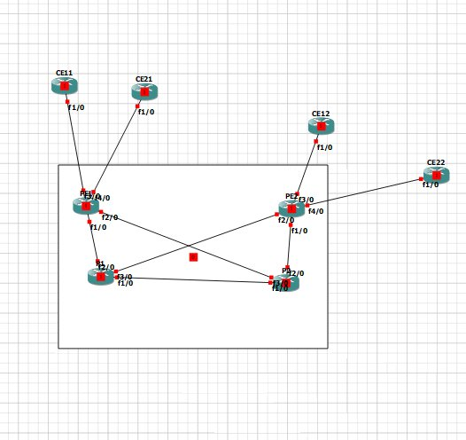
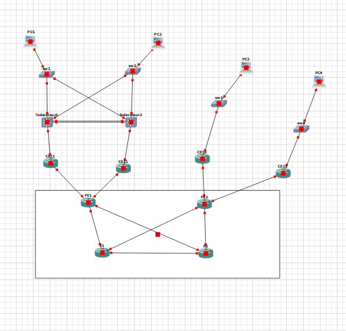
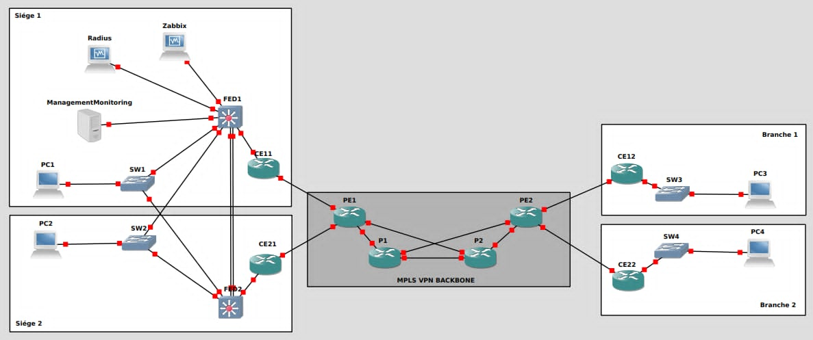

# GNS3 MPLS Cybersecurity Lab

Enterprise-style **IP/MPLS backbone** built and secured in **GNS3**, developed in four progressive phases: MPLS L3VPN core, VRF segmentation with HSRP redundancy, centralised AAA and monitoring, then redundant firewalls with a DMZ.

> Academic project - *Backbone IP/MPLS (NGN)*, Tekup, 2025-2026, supervised by Mr Tarek Hdiji.
> Authors: Med Aziz Salem, Laith Sahli, Farouk Bessouda.
> The full technical report (in French) is in [`docs/`](docs/Rapport_Final_MPLS_CYBER.docx).

## Architecture overview

| Part | Topic | Key technologies |
|------|-------|------------------|
| 1 | IP/MPLS backbone | OSPF (Area 0), MPLS/LDP, VRF, MP-BGP (VPNv4) |
| 2 | Advanced VRF "CYBER" | Single VRF `VPN_CYBER`, HSRP, VLANs, inter-VLAN routing, DHCP |
| 3 | AAA, management and monitoring | RADIUS, privilege levels, VTY ACLs, SNMPv3, Syslog, NTP, IP SLA, Zabbix |
| 4 | Firewalls and DMZ | 2x Cisco ASA in Active/Standby failover, DMZ (SMTP/WWW/DNS), ACL policy, IPS |

### Part 1 - Backbone IP/MPLS
2 Provider routers (P1, P2), 2 Provider Edge routers (PE1, PE2) and 4 Customer Edge routers, with each PE dual-homed to P1 and P2 for redundancy.



### Part 2 - VRF CYBER, HSRP and VLANs
Two VRFs are replaced by one `VPN_CYBER` (RD `100:3`). Headquarters uses two federating L3 switches in HSRP (Federateur1 active / priority 110, Federateur2 standby / priority 100), and the branches do inter-VLAN routing with DHCP.



### Part 3 - AAA, Zabbix, SNMPv3
Management VLAN with two admin laptops, a RADIUS server and a Zabbix server. Login goes through RADIUS with local fallback, management access is restricted by ACL to ADMIN1/ADMIN2, and traps, logs and IP SLA jitter/latency measurements are sent to Zabbix.



### Part 4 - Firewalls and DMZ
Two Cisco ASA 5505 firewalls in failover sit between the federating switches and the backbone. The DMZ `172.16.255.0/25` hosts SMTP (`.10`), WWW (`.20`) and DNS (`.30`). Policy:
- Siege and Branch users can reach the three DMZ services
- Direct Siege <-> Branch traffic is denied
- ADMIN1/ADMIN2 have full DMZ access
- IPS enabled on the inside and DMZ interfaces

## Repository structure

```
.
├── README.md
├── docs/        # Full technical report (French)
├── images/      # GNS3 topology screenshots
└── configs/
    ├── part1-backbone/
    ├── part2-vrf-cyber/
    ├── part3-aaa-monitoring/
    └── part4-firewalls-dmz/
```

## Addressing summary

| Item | Value |
|------|-------|
| Backbone links | `10.1.1.0/30` ... `10.1.1.20/30` |
| Loopbacks (router-ID) | PE1 `1.1.1.1`, PE2 `2.2.2.2`, P1 `3.3.3.3`, P2 `4.4.4.4` |
| VRF | `VPN_CYBER`, RD/RT `100:3`, BGP AS `100` |
| HQ VLANs | 10 (TEKUP1), 15 (TEKUP2), 20 (Management) |
| Branch VLANs | 201/202 (Branch1), 203/204 (Branch2) |
| Management servers | RADIUS `172.16.220.200`, Zabbix `172.16.220.250` |
| DMZ | `172.16.255.0/25` |

## Verification
The report includes a test plan covering DHCP, HSRP state, OSPF adjacencies, VPNv4 BGP session, VRF routes, inter-site pings, firewall failover, ACL isolation, IPS and Zabbix visibility. Examples:

```
show ip ospf neighbor
show mpls ldp neighbors
show ip bgp vpnv4 all summary
show ip route vrf VPN_CYBER
show standby brief
show failover
```

## Tools
GNS3, Cisco c7200 (IOS), Cisco IOU L2/L3, Cisco ASA 5505, Zabbix, RADIUS.

## Security note
Passwords, shared keys and SNMP credentials in `configs/` are **lab values** used in an isolated GNS3 simulation. Never reuse them on real equipment.

## Possible improvements
- Replace SNMPv3 MD5 with SHA + AES (authPriv)
- Replace Telnet with SSH-only management
- Export the full GNS3 project and device configs
